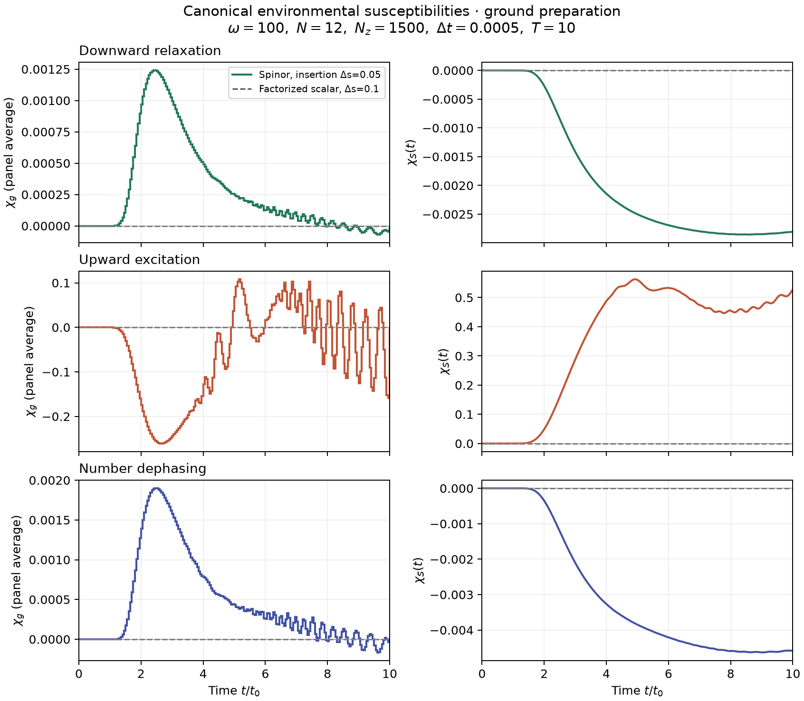

# Environmental Susceptibility of a Spin–Momentum Absorbing-Boundary Detector

Research code, compact numerical records, and CPU analysis for the open-system extension of [boundary spin–momentum filtering](https://github.com/jloOop/Boundary-Spin-Momentum-Filtering-Data). The question is how an unobserved transverse environment changes the **complete first-click law** of a fixed detector, including trials still undetected at the observation deadline.

Research snapshot accompanying a manuscript in preparation. This repository provides selected finite-model numerical results and code for reconstructing the included analyses. Analytical identities, operationally qualified zero-rate responses and finite-rate numerical observations are distinguished. Complete response-level refinement and finite-rate error assessment remain ongoing; historical simulation restart is not supported by this compact release.

## Physical mechanism

A trace-preserving transverse environment is invisible to the roof-integrated **scalar** click-time law under longitudinal–transverse factorization and a fixed longitudinal marginal. A spin–momentum boundary can instead make that law sensitive to transverse excitation, relaxation, and coherence:

$$
\dot{\widetilde\rho}
 =\mathcal L_{\mathrm{ABC}}^{\mathrm{nc}}[\widetilde\rho]
 +\sum_r\lambda_r\mathcal B_r[\widetilde\rho],
\qquad
K=\frac{\sigma_xp_y-\sigma_yp_x}{\hbar}.
$$

The roof is the sole monitored loss mechanism. The Hermitian boundary operator $K$ changes the surviving state; it is neither an extra absorber nor a bulk spin–orbit interaction. Environmental events remain unobserved and their recycling terms are retained.

For horizon $T$, survival $S(T)$ is the no-click probability, not a click at $T$. The restricted mean $\mu^*(T)=\int_0^T S(t)\,dt$ includes censoring and differs from the mean among detected trials, $[\mu^*(T)-TS(T)]/[1-S(T)]$ when $1-S(T)>0$. Saved roof-bin probabilities remain the primary numerical click record; survival is not differentiated to manufacture them.

## Principal results

At fixed preparation, susceptibility means $\chi_{X,r}=\partial_{\lambda_r}X|_{0^+}$, where $\lambda_r=\Gamma_{r,\mathrm{phys}}t_0$. These coefficients are **derivatives**, not finite-rate percentage changes.

| Canonical channel | $\chi_D(10)$, roof sum | $\chi_{\mu^*}(10)$ |
|---|---:|---:|
| Downward relaxation | +0.0028065318 | −0.0189238164 |
| Upward excitation | −0.52777048 | +3.55724785 |
| Number dephasing | +0.0045785318 | −0.0297474037 |

The [canonical register](data/canonical_response/CANONICAL_CASE_MASTER_TABLE.csv) identifies ground preparation, $\omega=100$, $N=12$, $N_z=1500$, $T=10$, detector step $0.0005$, and refined insertion/response-panel spacing $0.05$. Upward excitation acts on the ground preparation immediately. Downward relaxation probes excitation generated or selected during detector-present evolution. Number dephasing probes coherence-sensitive dynamics without itself changing oscillator number populations or energy.

*Canonical D2-I/U2-I/P2-I responses and matched scalar controls. Native signed roof-panel averages and independently stored survival responses use their own grids; scalar controls have 0.1 response panels. Source: the [18-case index](data/canonical_response/case_index.csv) and Task08 aggregate records.*

| Additional finding | Supporting record |
|---|---|
| Confinement dependence is non-monotonic in the tested extended family, without a universal scaling law. | [Matched descriptive table](data/extensions/confinement/Task08X_Detailed_Main_Summary.csv) |
| At $\omega=144$, ground/first-shell upward detection susceptibilities have opposite signs at both $T=10$ and $20$. | [Selected horizons](data/extensions/horizon/tables/selected_horizons.csv) |
| Exact affine preparation mixing cancels integrated detection response while preserving timing response. | [Archived response arrays](data/extensions/horizon/reconstructed_arrays.npz) |
| The same finite transverse operation has opposite effects at a common deadline when applied earlier or later. | [Operation comparison](data/extensions/causal_operation/endpoint_comparison.csv) |
| Equal-energy, equal-initial-RMS-momentum second-shell preparations have different detector laws; independent propagation tests a launch-kernel prediction. | [Second-shell endpoints](data/extensions/second_shell/endpoint_metrics.csv) |

*Upward response at $\omega=144$, $N=12$, $N_z=1500$, detector step $0.00025$, panels $0.05$. For the mixture $(1-p)\rho_{00}+p(\rho_{10}+\rho_{01})/2$, terminal cancellation occurs near $p=0.8104$ at $T=10$ and $0.8048$ at $20$, with nonzero restricted-mean response. This is an affine cancellation, not the scalar null or a phase transition. The figure reduces archived derived arrays; native kernel reconstruction is separate.*

## Finite-rate results — Task09

An unobserved upward-excitation bath acts on the transverse ground preparation at $\omega=100$, $N=12$, $N_z=1500$, with detector step $0.0005$. The three rates are $\lambda=\pi/3200,\pi/1600,\pi/800$. Each curve subtracts its **own paired zero**: $\Delta p_n=p_{\lambda,n}-p_{0,n}$ and $\Delta g_n=\Delta p_n/\Delta t_n$.

*Actual saved horizons: $T=6$ (π/3200), $10$ (π/1600), and $3.825$ (π/800). Later positive intervals partly recover the prompt detection deficit, while the cumulative change since launch remains negative at every saved endpoint. The standalone zero ends at $3.6$ and is a separate consistency check.*

The [finite-rate results page](data/finite_rate/README.md) shows cumulative changes, the matched U2-I tangent comparison, and the historical poster view ($5.65,8.3,3.6$), including its reproduced doubling statistic. [Compact native inputs](data/finite_rate/branches/) and the [reproduction command](REPRODUCING.md#finite-rate-views-and-outputs) support both views.

## Repository and quick start

- **Solvers/**: preserved generating implementations and selected configuration identities, grouped by scientific family.
- **Loaders/**: portable CPU reductions, figures, and release verification.
- **data/**: foundations, sixteen detector controls, eighteen canonical roles, extensions, finite-rate histories, figures, and a [release manifest](data/provenance/release_manifest.csv).
- **paper/**: [research-reference and detector-only context](paper/README.md).

From the repository root, after installing [requirements.txt](requirements.txt) in a Python environment:

~~~bash
python Loaders/reproduce.py --group canonical --output build/canonical
python Loaders/reproduce.py --group extensions --output build/extensions
python Loaders/reproduce.py --group finite-rate --output build/finite-rate
python Loaders/verify_release.py
~~~

See [REPRODUCING.md](REPRODUCING.md) for the tested environment, output definitions, and supported analysis subsets.

## Scope and citation

These are finite-model results, with operational qualification and incomplete full convergence acceptance. The operation sign contrast disappears at equal elapsed time; its late curvature test remains unresolved and does not establish bath non-Markovianity. Near-linear rate doubling is not a certified quadratic remainder or error bar. [PROJECT_SCOPE.md](PROJECT_SCOPE.md) separates archived evidence, tested saved-array analysis, missing simulation dependencies, and unavailable restarts.

**Author: Alireza Jozani.** Cite this repository using [CITATION.cff](CITATION.cff) and identify the commit used. No repository DOI or blanket redistribution license is asserted.
