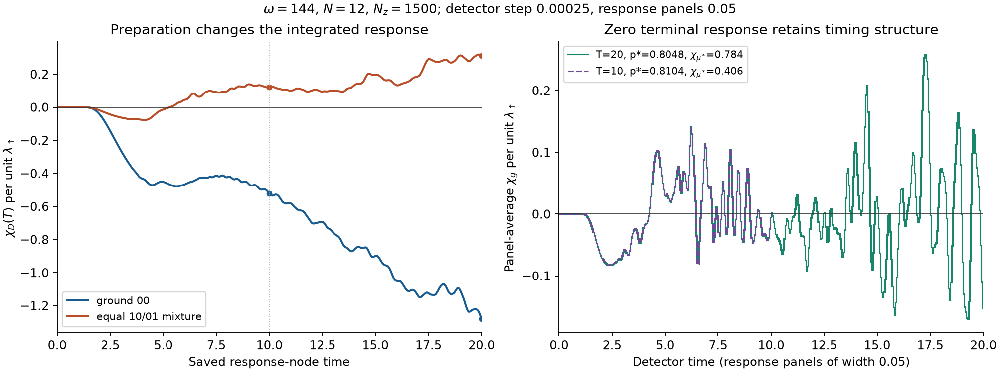
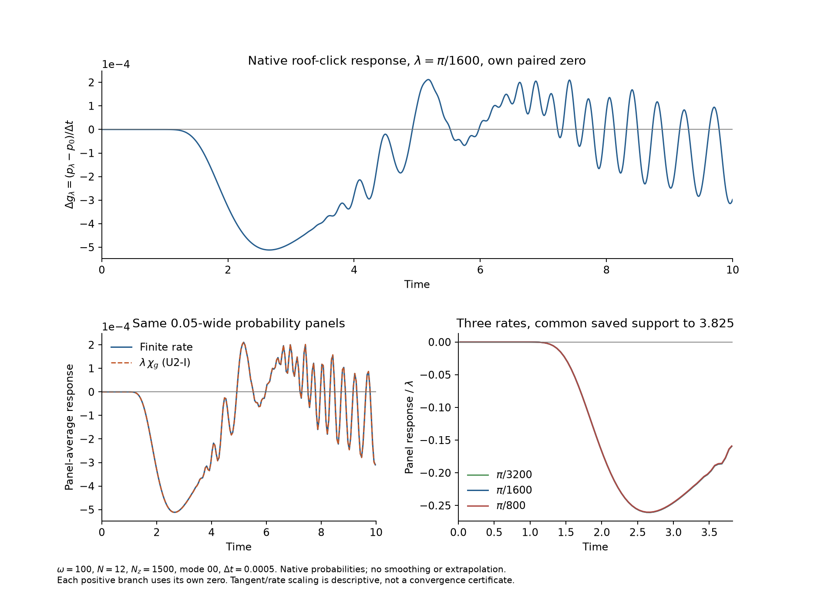

# Environmental Susceptibility of a Spin–Momentum Absorbing-Boundary Detector

**Alireza Jozani · ongoing, unpublished research**

How can an environment acting only on transverse motion change the time at which a particle is detected at the end of a guide? This repository studies that question for a fixed detector whose absorbing boundary couples spin to transverse momentum. It contains generating code, compact numerical records, and CPU analyses of **zero-rate environmental susceptibilities and finite-rate upward-excitation trajectories**.

This is the open-system extension of [boundary spin–momentum filtering](https://github.com/jloOop/Boundary-Spin-Momentum-Filtering-Data). The detector already makes the no-click evolution nonunitary; the extension adds an independent, unobserved transverse environment. The results accompany working lecture notes and draft studies, with full convergence assessment still in progress.

[Reproduce the saved-data analyses](REPRODUCING.md) · [Detailed finite-rate results](data/finite_rate/README.md) · [Evidence and limitations](PROJECT_SCOPE.md) · [Draft context](paper/README.md)

## Physical model and mechanism

A spin-1/2 particle moves in a harmonic transverse guide with a nondetecting Dirichlet lower wall and an absorbing roof. In numerical units with $`\hbar=m=1`$, the spin-independent bulk Hamiltonian and spinor roof condition are

$$
H_{\mathrm{bulk}}=\left[-\frac12\nabla^2+\frac{\omega^2}{2}(x^2+y^2)\right]I_2,
$$

$$
\partial_z\Psi=(i\kappa I_2-K)\Psi,
\qquad K=\sigma_xp_y-\sigma_yp_x,
\qquad p_j=-i\partial_j.
$$

The scalar control sets $`K=0`$. Both boundaries have the same positive local roof-loss density $`\kappa\Psi^\dagger\Psi`$, but they evolve different surviving states. The Hermitian operator $`K`$ acts through the boundary condition, with no added bulk spin–orbit interaction or second absorbing channel. For normal wave number $`k>0`$ and tangential magnitude $`R`$, the two local boundary branches have equal one-encounter absorption,

$$
A_+(k,R)=A_-(k,R)=\frac{4k\kappa}{(k+\kappa)^2+R^2},
$$

and generally different reflection phases. Thus transverse momentum affects detection through the evolving state and its encounters with the roof; this local formula alone does not determine the complete time distribution.

The unnormalized no-click state obeys the organizing master equation

$$
\dot{\widetilde\rho}
=\mathcal L_{\mathrm{ABC}}^{\mathrm{nc}}[\widetilde\rho]
+\sum_r\lambda_r\mathcal B_r[\widetilde\rho],
\qquad
\mathcal D[L]\rho=L\rho L^\dagger-\frac12\{L^\dagger L,\rho\}.
$$

The three environmental directions are $`\mathcal B_\downarrow=\sum_{j=x,y}\mathcal D[a_j]`$, $`\mathcal B_\uparrow=\sum_{j=x,y}\mathcal D[a_j^\dagger]`$, and $`\mathcal B_\phi=\sum_{j=x,y}\mathcal D[N_j]`$, where $`N_j=a_j^\dagger a_j`$. Raising/lowering refer to **orbital** excitation/relaxation. Number dephasing is independent in the two transverse directions and preserves oscillator populations and energy under its own action. All recycling terms are retained: bath events are unobserved, the summed bath evolution preserves trace, and the roof is the sole monitored sink. The upward-only runs are excitation controls, without an equilibrium thermal-bath interpretation.

One fixed time unit $`t_0`$ defines $`t_{\mathrm{phys}}=t_0t`$, $`\omega=\Omega_{\perp,\mathrm{phys}}t_0`$, and $`\lambda_r=\Gamma_{r,\mathrm{phys}}t_0`$. Numerical implementations use projected finite-shell operators and their declared finite-step maps.

**Exact scalar control.** When the scalar no-click map factorizes into longitudinal trace-decreasing and transverse/spin trace-preserving maps, changing the transverse environment at fixed longitudinal reduced state leaves the **complete roof-integrated time law** unchanged. The spin–momentum boundary can break this factorization and make that law sensitive to excitation, relaxation, and coherence. The [scope notes](PROJECT_SCOPE.md) distinguish this null from finite-step artifacts in nonfactorized scalar discretizations.

## What is measured

For the ideal detector law, normalized at launch,

$$
S(t)=\operatorname{Tr}\widetilde\rho(t),\qquad
g(t)=-\dot S(t),\qquad
D(T)=\int_0^T g(t)\,dt=1-S(T),
$$

$$
\mu^{\ast}(T)=\int_0^T S(t)\,dt,
\qquad
\overline\tau_{\mathrm{cond}}(T)
=\frac{\mu^{\ast}(T)-T S(T)}{D(T)}\quad[D(T)>0].
$$

Here $`g`$ is the first-click density, $`D`$ the detected fraction, and $`\mu^{\ast}`$ the restricted mean, including trials still undetected at $`T`$. The conditional mean uses only detected trials. Full-law comparisons retain the no-click probability $`S(T)`$ as a censoring outcome; it is not a physical click at the deadline or evidence of permanent nondetection. For compressed Task09 records, numerical mass losses require the separate accounting described below.

## Canonical zero-rate responses — Task07/08

At fixed preparation and detector, the susceptibility is the derivative at zero environmental rate, with other rates held at zero:

$$
\chi_{X,r}(T)=\left.\frac{\partial X(T)}{\partial\lambda_r}\right|_{\lambda_r=0^+}.
$$

These coefficients describe the leading change $`\lambda_r\chi_{X,r}`$; they are not themselves finite-rate percentage changes.

The [canonical register](data/canonical_response/CANONICAL_CASE_MASTER_TABLE.csv) specifies transverse ground preparation, $`\omega=100`$, $`T=10`$, detector step $`\Delta t=0.0005`$, and refined source-insertion/response-panel spacing $`0.05`$. The common longitudinal preparation has $`L_z=20`$, $`z_0=10`$, Gaussian **amplitude** width $`\sigma_z=0.5`$, $`k_0=\kappa=\pi`$, and $`N_z=1500`$. Its initial spin angles are $`\theta=\pi/6`$, $`\phi=0`$, using $`(\cos(\theta/2),e^{i\phi}\sin(\theta/2))^T`$. The endpoint-excluded grid places the roof at $`z_R\simeq19.98666573`$. The cutoff $`N=12`$ retains all shells $`n_x+n_y\le12`$: **91 orbital modes and 182 spin-resolved transverse channels**.

| Canonical environmental channel | $`\chi_D(10)`$, roof sum | $`\chi_{\mu^{\ast}}(10)`$ |
|---|---:|---:|
| Downward relaxation | +0.0028065318 | −0.0189238164 |
| Upward excitation | −0.52777048 | +3.55724785 |
| Number dephasing | +0.0045785318 | −0.0297474037 |

Upward excitation gives the dominant response for this preparation: reduced detection by $`T=10`$ and increased restricted mean. It acts on the ground state immediately. The smaller relaxation and dephasing responses probe excitation and coherence generated or selected during detector-present evolution. These signs concern the stated preparation and horizon.


*Canonical D2-I/U2-I/P2-I responses and matched scalar controls. Signed roof-panel averages and independently stored survival responses retain their own grids; scalar controls use 0.1 response panels. Sources: the [18-case index](data/canonical_response/case_index.csv) and Task08 aggregate records. Task08's operational finite-model response acceptance retains inherited representation and longitudinal allowances; the printed digits identify saved coefficients, not continuum accuracy.*

## Preparation, confinement, and observation horizon

The response depends on which transverse state reaches the detector and on the observation window. The following extensions retain their separate evidence and refinement status.

| Finding in the tested family | Supporting record |
|---|---|
| Confinement dependence is nonmonotonic; the sampled results establish no universal scaling law. | [Matched descriptive table](data/extensions/confinement/Task08X_Detailed_Main_Summary.csv) |
| At $`\omega=144`$, ground and first-shell upward detection susceptibilities have opposite signs at both $`T=10`$ and $`20`$. | [Selected horizons](data/extensions/horizon/tables/selected_horizons.csv) |
| Affine preparation mixing can cancel the terminal detection derivative while retaining a nonzero timing response. | [Archived response arrays](data/extensions/horizon/reconstructed_arrays.npz) |
| The same finite transverse operation has opposite effects at a common deadline when applied earlier or later. At equal elapsed time after the operation, both tested changes are negative. | [Operation comparison](data/extensions/causal_operation/endpoint_comparison.csv) |
| Equal-energy, equal-initial-RMS-momentum second-shell preparations have different detector laws; independent propagation tests a launch-kernel prediction. | [Second-shell endpoints](data/extensions/second_shell/endpoint_metrics.csv) |



*Upward response at $`\omega=144`$, $`N=12`$, $`N_z=1500`$, detector step $`0.00025`$, and panels $`0.05`$. For $`(1-p)\rho_{00}+p(\rho_{10}+\rho_{01})/2`$, the terminal detection derivative cancels near $`p=0.8104`$ at $`T=10`$ and $`0.8048`$ at $`T=20`$, while the restricted-mean response remains nonzero. This cancellation differs from the scalar control, where the full time law is invariant. The figure reduces archived derived arrays; full native-kernel reconstruction is a separate task.*

## Finite-rate upward excitation — Task09

The upward bath acts on the transverse ground preparation at $`\omega=100`$, $`N=12`$, $`N_z=1500`$, with detector step $`0.0005`$. Each trajectory is compared with **its own paired zero-rate history**. For native roof-bin probabilities,

$$
\Delta p_n=p_{\lambda,n}-p_{0,n},\qquad
\Delta g_n=\frac{\Delta p_n}{\Delta t_n},\qquad
\Delta C(T)=\sum_{t_{n+1}\le T}\Delta p_n.
$$

| Upward rate | Saved endpoint $`T`$ | Cumulative roof-detection change $`\Delta C(T)`$ |
|---|---:|---:|
| $`\pi/3200`$ | 6 | −0.000522840063 |
| $`\pi/1600`$ | 10 | −0.001034692343 |
| $`\pi/800`$ | 3.825 | −0.001798882845 |

These endpoints have different observation deadlines. All three rates overlap through $`3.825`$; the two lower rates overlap through $`6`$. The repository's later $`\pi/800`$ history extends beyond V10's selected native comparison to $`3.744`$ and separately reported $`3.8`$ endpoint; [draft provenance](paper/README.md) records the distinction. The standalone Task09 zero ends at $`3.6`$ and supplies a separate consistency check on that support.



*Native density changes through each saved endpoint. Prompt detection is suppressed. The longer histories show later positive and negative intervals; positive intervals recover part of the earlier deficit, while the launch-cumulative change remains negative at every saved endpoint. A positive late density or selected-window integral does not establish increased total detection.*

At $`\lambda=\pi/1600`$ and $`T=10`$, the detection change is approximately **−0.1035 percentage points**. The canonical linear prediction is $`\lambda\chi_D=-0.00103627491`$, close to the saved $`\Delta C=-0.00103469234`$. Matched-horizon rate doubling is likewise approximately linear. These are finite-grid consistency observations: the branches use different compression policies and event-sector caps, so their agreement does not provide a certified nonlinear remainder or total error bar.

The [finite-rate results page](data/finite_rate/README.md) retains cumulative and rate-normalized views, the matched U2-I tangent comparison, and the historical poster view with horizons $`5.65,8.3,3.6`$, including the reproduced doubling statistic and its rounding note. [Compact native inputs](data/finite_rate/branches/) and the [reproduction command](REPRODUCING.md#finite-rate-views-and-outputs) support both historical and extended views.

**Clicks and numerical loss are separate.** The retained-state accounting is

$$
S_{\mathrm{ret}}+C_{\mathrm{roof}}+B_{\mathrm{rep}}+B_{\mathrm{event}}
=S_{\mathrm{ret}}(0)+\varepsilon_{\mathrm{acct}}.
$$

Representation loss and omitted event-sector mass are recorded separately from roof clicks. Therefore the saved roof sum is not replaced by $`1-S_{\mathrm{ret}}`$, and survival is not differentiated or renormalized to manufacture click probabilities. Small accounting residuals and successful continuation checks establish their stated numerical properties; full finite-rate physical/convergence acceptance remains open.

## Repository and quick start

| Location | Contents and role |
|---|---|
| [Solvers/](Solvers/) | Preserved generating implementations and selected configurations, grouped into static, operator, bath-only, detector-control, canonical-response, and finite-rate families. |
| [Loaders/](Loaders/) | Portable CPU reductions and release verification; historical analysis sources remain under `Loaders/archive/`. |
| [data/](data/) | Task01–04 foundations; sixteen Task05/06 detector controls; eighteen Task07/08 canonical roles; extensions; Task09 histories; figures; and the [release manifest](data/provenance/release_manifest.csv). |
| [paper/](paper/README.md) | Working-draft provenance and the relationship to the detector-only study. |

From the repository root, install [requirements.txt](requirements.txt) in a Python environment and run:

```bash
python -m pip install -r requirements.txt
python Loaders/reproduce.py --group canonical --output build/canonical
python Loaders/reproduce.py --group extensions --output build/extensions
python Loaders/reproduce.py --group finite-rate --output build/finite-rate
python Loaders/reproduce.py --group foundations --output build/foundations
python Loaders/verify_release.py
```

These entry points reconstruct selected figures and tables from bundled arrays on CPU, writing to `build/`. [REPRODUCING.md](REPRODUCING.md) gives the tested release environment and exact scope of each group. Preserved production sources are available for inspection; this compact repository does not supply complete historical simulation runtimes, heavy-state restarts, or native reconstruction of every extension figure.

## Evidence status and citation

The project distinguishes analytical identities, operationally qualified zero-rate responses, and more provisional extended/finite-rate observations. Response-level longitudinal and representation refinement, finite-rate bath-step/compression studies, and complete error assessment remain unfinished. Complete positivity of a finite map, a historical `PASS`, or a release-integrity check is not a substitute for those convergence tests. The finite-operation timing contrast also does not establish bath non-Markovianity. See [PROJECT_SCOPE.md](PROJECT_SCOPE.md) for the precise retained qualifications and omissions.

The open-system extension has **no associated published paper at this stage**. Cite the repository using [CITATION.cff](CITATION.cff) and identify the commit used. The working PDFs are not redistributed here; no repository DOI or blanket redistribution license is asserted.
