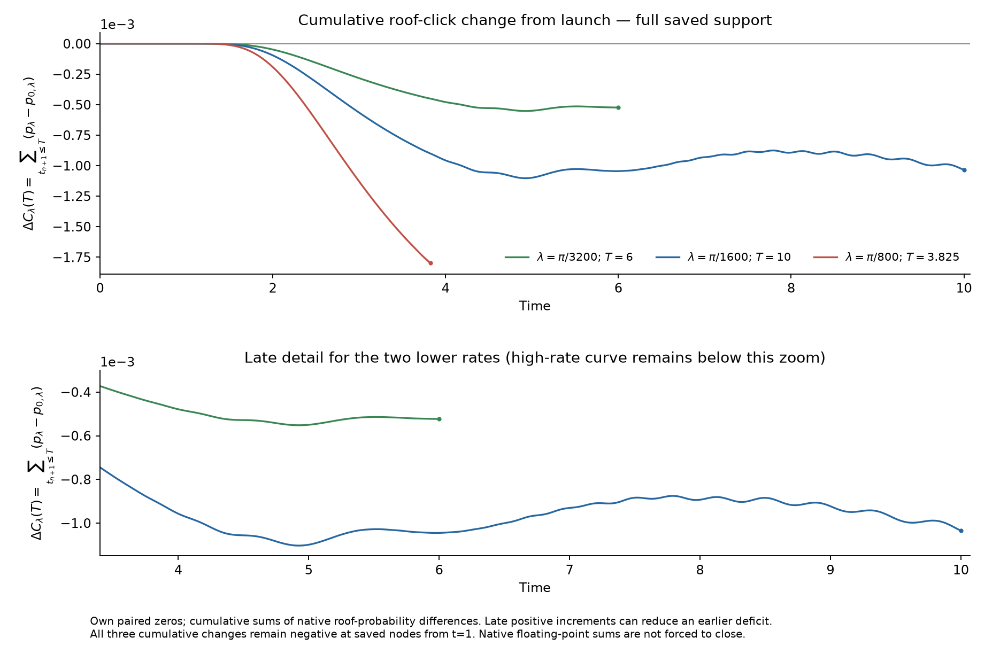
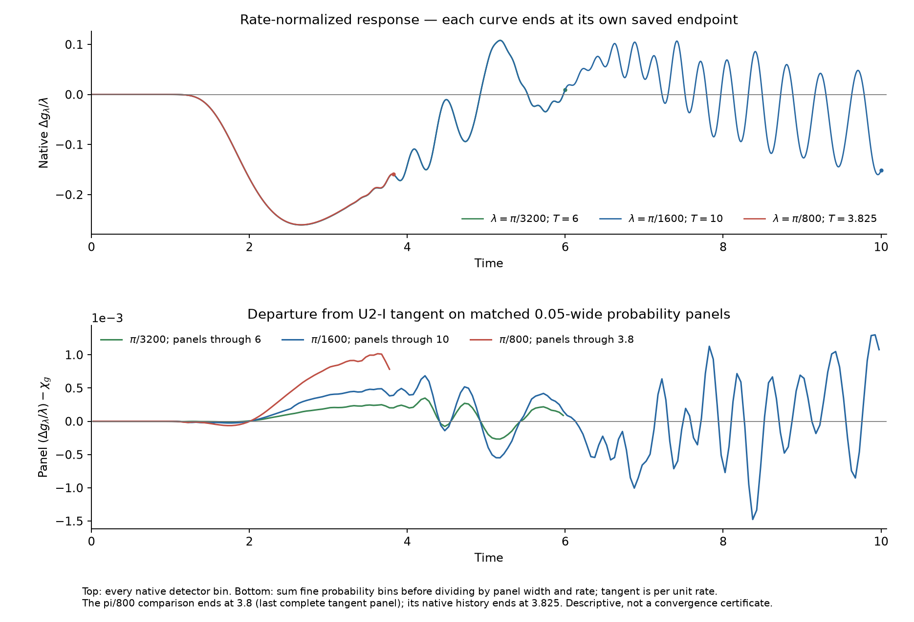

# Finite-rate results — Task09

The unobserved transverse upward-excitation bath acts on the ground preparation at $\omega=100$, $N=12$, $N_z=1500$, with detector step $0.0005$. The [main three-rate figure](../figures/finite_rate.png) shows native roof-bin differences against each trajectory’s **own paired zero**:

$$
\Delta p_n=p_{\lambda,n}-p_{0,n},\qquad
\Delta g_n=\frac{\Delta p_n}{t_{n+1}-t_n},\qquad
\Delta C(T)=\sum_{t_{n+1}\le T}\Delta p_n.
$$

These are changes in roof detection, obtained without differentiating survival, smoothing, renormalization or extrapolation. The π/800 branch retains its [repaired sparse-direct zero ancestry](poster_provenance/pi800_repaired_zero_ancestry.csv). The [standalone zero](branches/pi0/) stops at $3.6$ and is used only as a separate consistency check.

## Actual saved support

| Rate / compact input | Poster horizon | Extended horizon (step) | Extended endpoint $\Delta C$ |
|---|---:|---:|---:|
| [π/3200](branches/pi3200/) | 5.65 | 6 (12000) | −0.000522840063100 |
| [π/1600](branches/pi1600/) | 8.3 | 10 (20000) | −0.001034692342909 |
| [π/800](branches/pi800/) | 3.6 | 3.825 (7650) | −0.001798882845454 |

Horizons agree with native time arrays and committed checkpoint metadata. Each endpoint is a different observation deadline; compare rates using [matched horizons](results/matched_horizons.csv), not these endpoint values alone. Three-rate support ends at $3.825$; the two lower rates overlap through $6$.

## Cumulative response and late windows

The arrival region is suppressed. The two longer records first cross from negative to positive native density near $t=4.924$, then develop further sign changes. Positive intervals recover part of the cumulative deficit, but all saved endpoint $\Delta C$ values remain negative. Tiny pre-arrival positive values are retained and are not interpreted as resolved enhancement. [Sign-change brackets](results/significant_sign_changes.csv) use adjacent native bins, not interpolated roots.

The π/1600 extension shows why a positive late window is distinct from net enhancement:

| π/1600 window | Integrated $\sum\Delta p_n$ |
|---|---:|
| 6–8.3, poster-era late window | +0.000142307683034 |
| 8.3–10, added support | −0.000132166356499 |
| 6–10, combined late window | +0.000010141326535 |
| 0–10, cumulative since launch | −0.001034692342909 |

A positive bin average, a positive selected-window integral and a positive launch-cumulative change are different statements. The [window table](results/response_mass_windows.csv) retains positive and negative masses separately.

## Rate-normalized response and canonical tangent

The upper panel uses every native $\Delta g/\lambda$ bin on each branch’s saved support. For the lower panel, fine detector probability differences are **summed** onto the U2-I tangent’s complete $0.05$ response panels before dividing by panel width and rate. The π/800 tangent comparison therefore stops at $3.8$; its remaining $0.025$ is still shown in the native curve. No partial tangent panel is invented.

For π/1600 at $T=10$, the linear U2-I prediction is $\lambda\chi_D=-0.001036274911497$, compared with finite $\Delta C=-0.001034692342909$. The difference is $+1.582568588\times10^{-6}$, or a 0.1527% smaller deficit magnitude. This is a descriptive finite-rate consistency comparison.

For matched horizons, $R(T)=\Delta C_{2\lambda}(T)/(2\Delta C_\lambda(T))$ and $Q_C=\Delta C_{2\lambda}-2\Delta C_\lambda$:

| High / low rate | Common $T$ and view | $R(T)$ | $\lvert Q_C\rvert$ |
|---|---|---:|---:|
| π/1600 / π/3200 | 5.65, poster | 0.999281629 | $7.41776584\times10^{-7}$ |
| π/800 / π/1600 | 3.6, poster | 0.998856575 | $1.88131709\times10^{-6}$ |
| π/1600 / π/3200 | 6, extended | 0.999190520 | $8.46456756\times10^{-7}$ |
| π/800 / π/1600 | 3.825, extended | 0.998725581 | $2.29545601\times10^{-6}$ |

These native-increment sums use `math.fsum`. The [doubling table](results/integrated_rate_doubling.csv) includes the absolute residual and denominator rule; ratios with near-zero denominators are unavailable rather than connected through a singularity.

## Poster provenance

Section 6 of the supplied *BeyondC_A-Jozani.pdf* displays the $5.65,8.3,3.6$ view. The source association is supported by the [selected source identities](poster_provenance/selected_sources.json), native arrays, analysis definitions and unrounded statistic from `Stage09/V16_t=3.6to/Task09_Analysis_Sofat_20260917T180007Z/`. The [provenance note](poster_provenance/README.md) records the checks. The [historical view](../figures/finite_rate_poster.png) is regenerated from explicit cutoffs: [all 81 historical arrays](poster_provenance/prefix_verification.json), including time grids, positive and paired-zero histories, are exact prefixes of the bundled longer records. No duplicate snapshots or additional independent runs are introduced.

At $T=5.65$, [summing 11300 native differences](poster_provenance/integrated_rate_doubling_T5p65_recomputed.json) gives $R=0.9992816289790954$ and $100|R-1|=0.07183710209045513\%$. The poster prints approximately **0.9992** and **0.072%**. The deviation agrees with the unrounded calculation; nearest rounding of the ratio to four decimals is **0.9993**. The reason for the historical ratio’s display is not established. Subtracting separately accumulated cumulative curves changes only the last few digits and does not explain it. The historical statement is preserved, and the deviation is not inferred from 0.9992.

## Reproduction and supporting evidence

From the repository root:

~~~bash
python Loaders/reproduce.py --group finite-rate --output build/finite-rate
~~~

This regenerates all four finite-rate figures, the linked tables, `poster_regression.json`, and the existing A127 outputs from compact inputs in the checkout. Historical scalar comparisons use absolute tolerances $2\times10^{-14}$ for native sums and $2\times10^{-12}$ for ratios/deviations; historical CSV comparisons use absolute $2\times10^{-12}$ and relative $10^{-10}$ tolerances. [REPRODUCING.md](../../REPRODUCING.md#finite-rate-views-and-outputs) specifies the environment and full output scope. The [focused update checks](../provenance/finite_rate_update_checks.json) record the newly executed tests separately from historical audits. Source and distributed identities remain in the [release manifest](../provenance/release_manifest.csv); [A127](pi1600_analysis/) is the separate π/1600 analysis, not the three-rate comparison.

## Numerical policy and evidence scope

Compression policies and event-sector caps differ across branches; approximate doubling is not a certified quadratic remainder or full convergence result. Roof clicks, retained survival, representation loss, event omission, overflow diagnostics and accounting residuals remain separate. Active schedules are read alongside legacy fields: π/1600’s final active allowance is $6.25\times10^{-7}$ although its old ceiling field remains $2.25\times10^{-7}$. These bookkeeping terms are not complete observable error bars. [Historical evidence](evidence/) and acceptance flags remain unchanged; current checks concern saved arrays, metadata and reductions. No production dynamics, heavy-state restart, full spectral audit or unclosed bath-step/discretization convergence campaign is newly executed.
