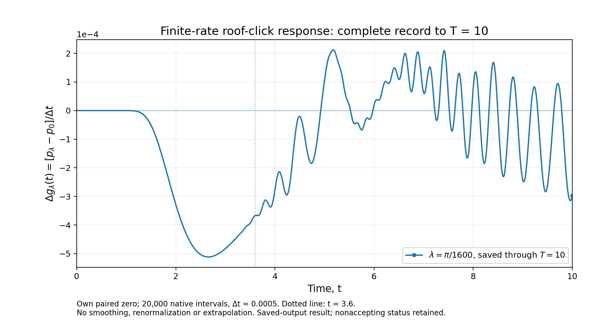

# Task09 pi/1600: verified saved record through T = 10

**Review date:** 28 September 2026. **Final job:** 3463660. **Immediate parent:** job 2966988, step 19327.

## Main finding

The uploaded archive contains the full 27-array native history from t = 0 through t = 10: 20,001 state nodes and 20,000 detector intervals at dt = 0.0005. The final allocation contributes 673 steps. The full 0-to-6 and 6-to-9.6635 histories are inherited, not rerun. All 27 inherited arrays match the immediate parent byte for byte, and the earlier separately uploaded 3.6, 6 and 8.3 records match on their full supports.

The finite-rate response is small, nonzero and sign-changing in time. At T = 10, the cumulative roof-click difference against this run's own paired zero remains **-0.00103469234291398**, or **-0.201372159%** relative to the paired zero detected mass. Positive late intervals do not erase the accumulated detection deficit. This is a verified saved-output result; all nonaccepting scientific flags remain unchanged.

## Definitions and primary sources

Source archive: `Task09_Pi1600_S19327_To1000_PC2_H100_v1_IO200_Result_3463660.zip`

SHA-256: `a448831dcef3c4f49675cee51a02a80af554df5d8a1bc765cec0f0124434a537`

The primary numerical member is `OUTPUT/block_histories.npz`; `OUTPUT/checkpoint_step20000/histories.npz` is byte-identical. Output status, checkpoint metadata, independent-audit and wrapper/port records all agree on completed and persisted step 20000.

For each native detector interval, delta_g = (positive_step_click - zero_step_click)/dt at (times[n]+times[n+1])/2. C is the sum of recorded roof increments, not 1 minus retained survival. Each difference uses this trajectory's own paired zero. No curves are inferred from survival differentiation. No smoothing, interpolation, extrapolation, sample removal, or renormalization was applied. Only the separately labeled tangent comparison aggregates native probabilities into matched 0.05 panels.

The reference report `Task09_V16_Verified_Comparison_Report.pdf`, Figure 1 and page 3, supplies the definition and methodological comparison. Its old endpoints are not current input limits. This review updates pi/1600 only; it does not infer longer pi/3200 or pi/800 trajectories from this upload.

## Endpoint values

| Quantity | Saved value |
|---|---:|
| S_pi1600(10), retained | 0.4872131065262048 |
| S_0(10), paired zero | 0.4861790486478761 |
| C_pi1600(10), roof | 0.5127862590220708 |
| C_0(10), roof | 0.5138209513649847 |
| delta_C(10) | -0.001034692342913979 |
| delta_S_retained(10) | 0.001034057878328665 |
| B_rep(10) | 6.249954120994585e-07 |
| B_event(10) | 9.467110323931381e-09 |
| Total retained rank | 935 |

C_pi1600 is 51.2786259022% and C_0 is 51.3820951365%. The difference is -0.1034692343 percentage points, equivalent to about 1034.69 fewer recorded roof clicks per million initial preparations. Digits identify the saved calculation, not continuum precision. Retained survival is about 0.487 at the horizon, so T=10 is not an asymptotic nondetection determination.

The endpoint metadata's positive and zero state traces differ from the corresponding history entries by about 1.11e-16, due to distinct floating reductions. Both original values are preserved; this review uses native history values for curves.

## Time-resolved response

The strongest native negative response is -0.0005116184049386 at midpoint 2.65625; the largest positive response is 0.0002118343775802 at midpoint 5.17725. These are extrema of the difference curve, not shifts of the absolute click-density peak.

The first late sign change is bracketed by midpoint 4.92375 and 4.92425. There are 18 adjacent-bin sign changes after t=1.2, excluding the pre-arrival numerical floor. They are listed in `sign_changes.csv`; the brackets do not locate a continuous-time zero to sub-bin accuracy and do not supply per-bin error bars.

The last detector interval is [9.9995, 10], at midpoint 9.99975. Its delta_g is -0.0002973708769202; its relative difference to the local paired-zero density is -1.1843525%. A last-bin relative value is not the cumulative percent change.

## Window decomposition

All window masses below are unconditional with respect to the launch ensemble. Neither branch is renormalized at a window boundary. Positive/negative masses are sums of positive/negative delta_p bins.

| start | end | roof pi/1600 | roof paired zero | net delta_C | positive mass | negative mass |
|---|---|---|---|---|---|---|
| 0 | 3.6 | 0.36522097609401255 | 0.36604364374384696 | -0.0008226676498343729 | 2.825719724718706e-18 | -0.0008226676498343757 |
| 3.6 | 6 | 0.10499508843638342 | 0.10521725445599318 | -0.00022216601960976822 | 7.553982116982621e-05 | -0.00029770584077959443 |
| 6 | 8.3 | 0.022842173484496683 | 0.02269986580146238 | 0.00014230768303430432 | 0.00019014571518709741 | -4.783803215279309e-05 |
| 8.3 | 10 | 0.019728021007182975 | 0.01986018736368227 | -0.00013216635649929576 | 4.7980682676302144e-05 | -0.0001801470391755979 |
| 6 | 10 | 0.04257019449167966 | 0.04256005316514465 | 1.0141326535008576e-05 | 0.00023812639786339955 | -0.000227985071328391 |
| 3.6 | 10 | 0.14756528292806306 | 0.14777730762113783 | -0.00021202469307475967 | 0.0003136662190332258 | -0.0005256909121079855 |
| 9.6635 | 10 | 0.0042014699364324145 | 0.004239204263890591 | -3.773432745817597e-05 | 8.550908133640598e-06 | -4.6285235591816565e-05 |
| 0 | 10 | 0.5127862590220756 | 0.5138209513649847 | -0.0010346923429091325 | 0.0003136662190332286 | -0.0013483585619423612 |

Between 6 and 8.3 the response adds +0.0001423076830343043 roof probability. Between 8.3 and 10 it adds -0.0001321663564992958, cancelling most of that gain. The complete 6-to-10 interval has only +0.00001014132653500858 net added probability. The entire 3.6-to-10 interval is net negative (-0.0002120246930747597).

The deepest cumulative deficit is -0.001102798850987 at node 4.924. By T=10 it has recovered 6.810650807315e-05 toward zero, but never closes the post-arrival cumulative deficit over the supplied window.

The integral of the retained-survival difference, using native-node trapezoids, is 0.006973068095001. The mean time among recorded clicks before T=10 is 3.37211178927 for pi/1600 and 3.371881587734 for the paired zero, a difference of 0.0002302015364442. This is not a uniform delay assigned to individual trajectories.

## Archived tangent comparison (separate diagnostic)

The exact original U2-I case ZIP from the earlier uploaded Task07 archive was reopened; SHA-256 3ec8ff21a633105aa713f1eb95ebe4a104b1ae4ba5801ec8a2eee8d47188b1db. All 14 solver-manifest hashes match. Its survival and jump-plus-anticommutator kernels independently reconstruct the saved response arrays exactly. It is copied as `reference/U2I_native_case.zip`.

At the same T=10, its integrated susceptibility from panel probabilities is -0.527770478614009. Multiplying by pi/1600 predicts -0.00103627491149709; the native finite-rate difference is -0.00103469234291398. The finite response is about 0.152717% smaller in magnitude than this linear prediction. This percentage measures departure of the cumulative *response* from the tangent prediction, not the percent change of the original distribution or the total numerical error.

The comparison sums native finite-rate detector increments into the original 200 panels of width 0.05 without interpolation. The complete panel-record residual (including the retained no-click atom) is 4.396204203502e-06. This is a numerical residual diagnostic, not a certified physical curvature value. The tangent has 1e-12 response-reference/branch GMRES accuracy; the finite-rate path uses its own frozen accuracy. Insertion quadrature, finite bath-map effects, compression/state approximation, and discretization uncertainties remain separate. One positive rate at T=10 does not prove a rate-halving law or convergence. No fresh multi-rate T=10 claim is made.

## Fresh verification scope

- Exact outer ZIP, evidence text and SHA256SUMS identities match the completion record.
- All 2237 outer artifact-manifest payloads were read completely, checking CRC and SHA-256; 152 package checksum entries match.
- Embedded immediate-parent compact: 30 manifest entries and 28 additional pinned subset entries match. Its 0-to-9.6635 history and all 27 prefixes are exact. The full older 2966988 result ZIP was not separately supplied here and was not newly audited.
- Each earlier separately supplied 0-to-3.6, 0-to-6 and 0-to-8.3 history matches all 27 arrays. Four new checkpoint histories are exact prefixes of the final record.
- The original step-5496 anchors and all 29008 representation / 14504 event terms are preserved. Every full-step ledger from 5497 through 20000 was independently recomputed with math.fsum. This does not recertify missing pre-5496 spectral ancestry.
- All 1346 new compression spectra were reconstructed from their raw sector eigenvalues, including every one of 3,686,611 rank-ladder entries, admissibility masks, minimum admissible ranks, sector allocations and charges. Small negative raw Gram mass is preserved in diagnostics; it is not silently deleted from the evidence.
- All 673 new detector records and 10095 batches have completed/no-failure status, contiguous column partitions, bounded residuals and exactly reconstruct the native positive and zero click sums.
- The global H10 policy is unchanged across the 19327 restart, and every new compression is within its active allowance. The driver and selected core modules match the parent and original IO200 package bytes.

The maximum accumulated positive closure residual is 1.40316647e-11; the corresponding paired-zero value is 1.48425716e-11. These are accounting residuals, not complete error bars on the detector response. The supplied independent standalone zero only extends to t=3.6; no independent later zero run is fabricated.

## Preserved discrepancy and unavailable evidence

The raw `representation_ceiling` history remains the inherited constant 2.25e-7 after its relevant old stage. It is not the active H10 limit. The actual T=10 ceiling is 6.25e-7, with remaining margin 4.5879005415e-12. Raw arrays remain unchanged. `Nodes_6_to10.csv` supplies separately named active_H10_prospective_ceiling and active_H10_reserve_margin columns, computed from CONFIG with 60-digit Decimal precision. No operational budget violation was found in the checked calls.

The four new checkpoint manifests reference 24 heavy factor payloads absent from this exported ZIP. Their hashes/traces were recorded on PC2, but those factors were not independently read here. This export supports the stored detector curves, not arbitrary density-matrix observables or a restart on another machine. Earlier full spectral/telemetry records are not automatically part of the child archive just because the full scalar history is inherited. Keep the original PC2 checkpoints and result archives.

The saved flags remain physical_claim=false, production_authorized=false, task10_eligible=false, automatic_resume=false. The named CERTIFIED_PI1600_CONTINUATION_TO1000 classification is a numerical workflow status, not a blanket physics/convergence claim.

## Use in the existing analysis

Treat `original/OUTPUT/block_histories.npz` as the single complete pi/1600 curve through T=10 after the verified overlap checks. Do not append the earlier prefixes again. Keep all other rates at their own verified endpoints; compare rates only on common available support. The new first-plot input is data/Plot_Data_0_to10.npz (delta_g against own paired zero). Full-resolution node/interval CSVs are also provided for 0-to-10 and 6-to-10.

No original input or solver was modified, no PC2 job was run, and no GPU propagation was performed during this review.
